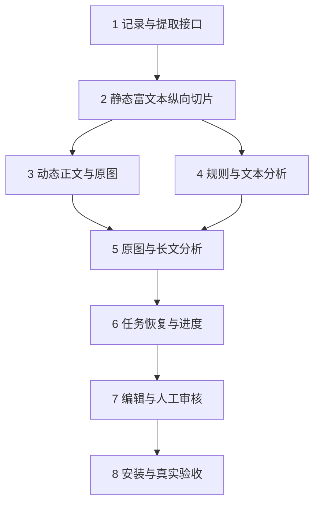

## 0. 实施约定与依赖

本清单按用户确认实施第一期。每项任务在完成其验证并留下证据前保持未勾选；未执行、缺少前置条件或待真实验收不能标为完成。[设计](design.md) 定义方案，[验收矩阵](acceptance.md) 中 AC 编号定义完成证据，[实施记录](verification.md) 登记实际结果；不在根目录另建重复任务清单。

共享 schema、索引与依赖清单修改串行。完成 1 和 2 的接口后，3 的站点/资产 fixture 与 4 的规则/分析 fixture 可以并行；Client 只按已冻结接口接入。每个编号任务以约 2–5 个主要文件为目标，若实际超出则先拆为子任务；各切片同时包含必要测试，最后阶段不补救前面缺少的基本覆盖。

当前状态：27 项 DONE（已勾选）；8.4 为 BLOCKED，由用户手动执行 AC-25。实际证据及检查限制见 [实施记录](verification.md)。

## 1. 记录与提取接口

- [x] 1.1 定义正文块、资产、质量和源哈希 schema 及纯计算函数；主要文件：shared contracts、toolkit contracts/提取类型和所属测试；验证 AC-01、AC-04 的结构与图片变更正反例；依赖：无。
- [x] 1.2 定义 AnalysisInput、理解结果、ImagePlan、WorkflowRun 和审核版本引用；主要文件：shared schemas 及校验测试；验证 AC-08、AC-09、AC-15 的缺字段、失效引用和错版本拒绝；依赖：1.1。
- [x] 1.3 实现索引/不可变正文快照/资产文件的原子提交和 ID 读取；主要文件：Host store、asset store 和所属测试；验证 AC-05、AC-17 的半写、越界、孤立引用及总量限制；依赖：1.1、1.2。
- [x] 1.4 实现 schema:1 备份及可恢复迁移，保留旧 ID/正文/方案/历史审核并标记需重抓；主要文件：migration、store、旧记录 fixture 和测试；验证 AC-18，迁移前后旧文件字节不变，失败不发布半成品；依赖：1.3。
- [x] 1.5 将 toolkit 纳入显式 workspace 与插件生产依赖，更新对应锁文件并保留现有导出；主要文件：workspace/package 清单、锁文件及依赖检查；验证 AC-20 的源码生产依赖解析，为下一切片提供正式包导入路径；依赖：1.1。

## 2. 静态富文本纵向切片

- [x] 2.1 从现有工具包提取不拥有业务状态的 ESM 内核入口，工作台调用同一实现；主要文件：toolkit exports/内核、Host capture adapter 和测试；验证 AC-01、AC-20 的真实调用关系，独立 MCP 仍用同一提取代码；依赖：1.1、1.5。
- [x] 2.2 用真实 Chromium 本地 fixture 完成浏览器到正文块的静态抓取，保留标题/列表/表格/链接，剔除无关区并净化预览；主要文件：toolkit articles/prune、fixture 和测试；验证 AC-01、AC-06，不用 fakeLauncher 代替浏览器证据；依赖：2.1。
- [x] 2.3 工作台经 Host 保存并展示富文本快照、质量和旧数据标记，提供引用定位基础；主要文件：Host service、Client store/reader、locale 和所属测试；验证 AC-02、AC-16、AC-18，保留未保存修改提示；依赖：1.4、2.2。

## 3. 动态正文与原图

- [x] 3.1 实现剪枝前图片候选/图注采集与有界资产获取，保留多次出现及本地读取；主要文件：toolkit media、Host asset adapter、fixture 和测试；验证 AC-03、AC-04、AC-05；依赖：1.3、2.2。
- [x] 3.2 实现有预算的正文滚动/延迟加载和适配器识别的同文章分页，输出完整性诊断；主要文件：renderer、站点适配入口、动态 fixture 和测试；验证 AC-02、AC-03、AC-07，摘要超过最小字数也必须检查后文；依赖：3.1。
- [x] 3.3 展示原图、图注及失败位置，接入来源核对与重新抓取，阻止缺图/缺段进入自动分析；主要文件：Host quality/review、Client reader、locale 和测试；验证 AC-02、AC-03、AC-16，核对不能覆盖已知缺失；依赖：2.3、3.2。

## 4. 规则与文本分析

- [x] 4.1 将规范草案拆入包内共享 references 与运行时模板，更新现有两个 Skill 的引用；主要文件：skills 下的所属文件、模板和加载测试；验证 AC-08、AC-22，Skill 与后台读取同一领域规则；依赖：1.2。
- [x] 4.2 实现 profile 编辑规则解析、固定优先级与内容快照，绑定分类/语言/备注及显式模型配置；主要文件：config schema、rules/input resolver 和测试；验证 AC-08、AC-09，文件缺失/无效时不得启动模型；依赖：4.1。
- [x] 4.3 通过 DSH 创建单篇专用分析会话，限制工具并记录输入 receipt，实现任务绑定的阶段/方案提交；主要文件：analysis runner、scoped tools、service 和测试；验证 AC-10、AC-11、AC-13，idle 不代表提交成功；依赖：1.3、4.2。
- [x] 4.4 完成文本文章从合格提取到理解稿/配图提示词/检查/待审核的自动纵向切片；主要文件：workflow、analysis validation、keyless fixture 和回放场景；验证 AC-10、AC-12、AC-22，无需复制到聊天；依赖：2.3、4.3。

## 5. 原图与长文分析

- [x] 5.1 接入已保存原图的 DSH 附件输入，记录实际图像/衍生图清单与能力检查；主要文件：analysis attachments、input manifest、测试；验证 AC-09、AC-11，有图但无视觉能力进入待配置；依赖：3.3、4.4。
- [x] 5.2 实现章节分块、全块/全图覆盖和全文综合，在总预算不足时报告缺口；主要文件：analysis chunker/synthesis、长文 fixture 和测试；验证 AC-11、AC-12、AC-22，拒绝只分析首块；依赖：5.1。
- [x] 5.3 实现理解证据、图意差异、数量缺口和场景/提示词一致性检查，更新结构化方案消费者；主要文件：plan validation、原生工具、toolkit tools 及测试；验证 AC-12、AC-15、AC-19，不能把自评分当语义验收；依赖：5.2。

## 6. 任务恢复与进度

- [x] 6.1 为单篇/批次接入 Jobs、持久状态及跨进程互斥，所有提交检查 attempt/输入/开始版本；主要文件：workflow/store、Host tools 和并发测试；验证 AC-13、AC-14，双启动与迟到提交均有拒绝证据；依赖：5.3。
- [x] 6.2 接通停止、功能停用与卸载的取消/drain，异常重启呈现中断，显式恢复沿用输入及已提交检查点；主要文件：runner lifecycle、service、恢复 fixture 和测试；验证 AC-14、AC-21，取消不能继续下一阶段；依赖：6.1。
- [x] 6.3 状态接口和页面显示真实阶段、耗时、可测计数、错误与恢复入口，关闭页面只停止订阅；主要文件：Host status、Client store/progress、locale 和测试；验证 AC-13、AC-16、AC-21，模型生成阶段不伪造百分比；依赖：6.2。

## 7. 编辑与人工审核

- [x] 7.1 增加理解稿、来源定位和配图卡片编辑，保护草稿并标识场景/提示词不同步；主要文件：Client workbench/editor、locale 和交互测试；验证 AC-15、AC-16，轮询与文章切换不覆盖草稿；依赖：5.3、6.3。
- [x] 7.2 实现精确版本的工作台批准及失效，区分采用的新规则/业务字段与无关来源行变化；主要文件：Host review/service、Client approval 和测试；验证 AC-15、AC-19，Agent 无批准工具；依赖：7.1。
- [x] 7.3 为成功、批准、重试、恢复和批量路径添加无生图/无上传发布/无表格回写断言，保留生成不可用说明；主要文件：workflow acceptance tests、工具/路由目录测试、locale；验证 AC-23；依赖：7.2。

## 8. 安装与真实验收

- [x] 8.1 核对已接入的 workspace/生产依赖，补必要的应用打包清单、规则/模板/提取入口的实际 tarball 安装测试和浏览器就绪检查；主要文件：打包清单与包装测试，超出文件目标时拆子任务；验证 AC-20，不发布或更新用户运行中的插件；依赖：1.5、2.1、4.1、7.3。
- [x] 8.2 更新受影响 README/JSDoc、中英文 locale、独立 MCP 兼容说明及必要 upgrade guide/持久类型记录，补所属 keyless session snapshot；主要文件：对应 owner 文档与场景，按各自 owner 分次提交；验证 AC-18、AC-22、AC-24；依赖：8.1。
- [x] 8.3 以真实浏览器验证静态/动态本地 fixture 与工作台完整流程、亮暗主题、窄屏和键盘；记录零生图请求及完整清理证据；主要文件：所属浏览器验收与结果记录；验证 AC-01 至 AC-07、AC-13 至 AC-16、AC-21、AC-23；依赖：8.2。
- [ ] 8.4 BLOCKED（用户手动验收 AC-25）：用获准的公开站点代表文章与配置好的真实分析/视觉模型做语义验收，按人工标注评估主旨、事实、图意和提示词，修复后复验失败样例；证据存所属验收记录；验证 AC-25；依赖：8.3，真实模型与样例未具备时保持 BLOCKED 且不勾选。

## 9. 检查点与交付

完成第 2 组后，应已能在工作台核对静态富文本；完成第 4 组后，应已能自动处理无图文章并保存待审核方案；完成第 5 组后，原图与长文进入同一链路；完成第 7 组后，人工审核构成本期终点。每次切片先跑聚焦验证，再按实际变更选择相关检查，不默认运行整仓测试或全量覆盖。

最终实施交付必须留下 [验收矩阵](acceptance.md) 的实际证据；OpenSpec 校验通过只说明文档可解析。代码/模拟测试/真实浏览器/真实模型/人工判断分别报告，缺少后两类证据时不得称业务已全部验收。
