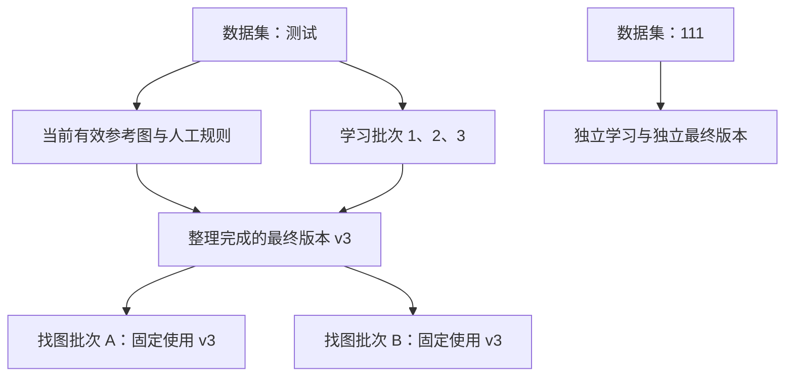

# 数据集主体与多轮学习整理分析

此文给出需求理解和建议方案。数据集整理机制及找图弹窗的选择层级尚未按此方案修改；当前数据、历史包和已有任务均保留。

## 需求理解

“测试”“111”是两个独立、长期维护的数据集主体。每个主体可以不断导入参考图、分析风格、调整规则、记录新的学习批次；它们的资料不能混在一起。数据集页里的每一行历史生成包属于某次分析或某个版本，不应在找图时变成一组需要用户逐项判断的独立数据集选项。

点击“按此画像找图”时，应选择上层数据集主体，再由系统取得它已经整理完成的最终有效版本，冻结并发送一份完整参考包。一个主体内部可以有多轮学习，但一次找图使用的资料必须明确、可重复读取。不同主体之间没有自动合并。

## 当前代码实际做法

| 现有对象 | 当前含义 | 建议向用户呈现的含义 |
| --- | --- | --- |
| `style` | 顶部切换的素材集，拥有独立 draft、参考图与规则 | 数据集主体 |
| `run(kind=analyze)` | 一次图片观察与风格提炼任务 | 学习批次或分析记录 |
| `modelProfile` | 固定参考身份、规则选择及风格组的不可变画像 | 最终版本采用的风格画像 |
| `profileExport` | 某个确定画像的冻结参考包 | 最终版本文件或历史版本包 |
| `run(kind=search/crop)` | 一次独立找图或裁剪执行 | 找图/裁剪任务批次 |

[ModelProfiles](../../../custom-plugins/workspace/dsh-plugin-visual-curator/src/domain/model-profile.ts) 以当前指针选择画像。成功分析会创建或采用新画像，人工规则及仍有证据的用户选择会被保留；它不会把所有旧自动规则无条件相加。画像引用的是本次分析的样本集合。

[数据集目录](../../../custom-plugins/workspace/dsh-plugin-visual-curator/src/host/datasets.ts) 将 export Run 与 `profileExport` 投影成当前分组下的条目。当前找图启动则要求明确的 exportId，并核对其 modelProfileId、analysisRunId 和内容摘要必须与当前画像相符；校验位于 [search-launch.ts](../../../custom-plugins/workspace/dsh-plugin-visual-curator/src/host/search-launch.ts)。因此，当前确实是在选择某份历史生成包，而不是解析一个上层数据集的最终有效版本。

这里的“训练”目前指图片分析、风格归纳及规则沉淀，代码没有对视觉模型做微调，也没有产生训练后的模型权重。

## 整理不是拼接历史 JSON

如果后续分析每次读取同一参考库的全部有效图片，那么新的完整分析已经覆盖当前参考集；这时应整理最新有效画像并导出，不能把旧包里的相同图片和过时规则重复加入。若以后允许每轮只分析新增图片，则要先建立按图片版本记录的观察集合，再按当前有效参考集整理，不依靠历史包数量推断覆盖范围。

推荐的有效资料顺序是：人工明确保留/排除及修改的规则优先；同一图片版本的重复观察合并；已移除或已被替换的参考不再进入默认最终版；模型之间冲突的观察保留未决信息，不能平均成“已确认”；互斥风格继续保留为备选组，不要求同时满足。

例如，“测试”第一轮分析 10 张汽车参考，第二轮追加 10 张秋日环境参考，第三轮关闭黑白偏好。最终包应包含当前有效的参考和当前规则选择；不应成为三个包简单拼接后的重复样本，也不能从第一轮重新带回第三轮已关闭的偏好。

## 建议实现

1. 保持顶部主体切换和数据隔离。数据集页面突出一份“当前最终版本”，下面保留学习批次和历史版本记录；历史记录仍可查看、下载及追溯，但不作为默认找图选项。
2. 每轮成功学习后，将当前有效样本、观察、人工规则、启用规则、备选组和匹配说明整理为新的不可变最终版本。记录纳入的分析 Run、参考版本、画像 ID 和摘要；完成后原子更新主体的最终版本指针。
3. 整理失败或新分析未完成时，不覆盖上一份成功最终版。界面同时显示“可用最终版”和“尚未纳入的新变更”，明确找图将使用哪个版本。新增资料需要图像分析时按现有预算执行；已有画像仅重新整理、导出时不重复调用视觉模型。
4. 找图弹窗选择主体，默认当前主体，显示其最终版本号、整理时间、参考数与规则数。没有可用最终版时提示先完成学习/整理。选择具体历史版本只作为可选的高级入口。
5. 启动请求由 Host 解析并核对主体和最终版本，冻结版本 ID、画像摘要、完整包校验和、规则、来源及预算，再发送一份整理后的参考包。不得只修改下拉框文案而继续使用不对应的旧画像。
6. 学习中的新版本不修改已经开始的找图任务。结果仍归于原始数据集主体及执行批次，并记录所用最终版本，避免后来的整理使旧结果失去解释。

## 需要保持的约束

- “测试”和“111”的参考、规则、最终包及找图结果始终隔离；合并只发生在同一主体内部的有效学习资料之间。
- 历史学习包和旧任务的冻结输入不覆盖、不删除。当前人工排除和规则修改不能被旧模型输出重新启用。
- 汇总后的包不是“把所有历史材料都发送给 Agent”。移除重复描述、历史对话及无效规则，只发送当前执行需要的完整资料和来源记录。
- 最终版本不是把未知证据改为确认，也不是降低匹配阈值；预览匹配仍只表示已审核的预览符合当前固定规则。

## 实施范围

后续需要一起调整最终版本指针/导出、学习完成后的整理、数据集页面、找图弹窗和启动校验；不能只换选择器。可复用现有 `style`、`modelProfile`、`profileExport` 和启动幂等机制，避免为每轮学习创建新的顶层主体。正式实施前应确认“多轮学习保留当前全部有效参考、人工规则优先、每次找图固定一份成功最终版”这一默认语义。
